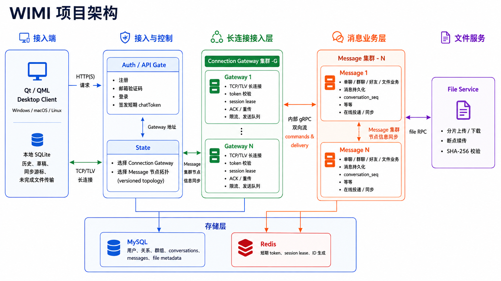

  

<h1 align="center">WIMI</h1>

  An experimental C++20 instant-messaging project. 
  <a href="README.zh-CN.md">简体中文</a> · English

> **Experimental.** WIMI is a learning and engineering
> experiment.

  

## Functionality

WIMI provides a Qt/QML desktop chat client backed by a C++ service stack. It
currently focuses on reliable, usable system capabilities, including:

- Account registration, email verification, sign-in, and reconnecting through
  the Auth Gate.
- Direct conversations, group text messages, delivery/read acknowledgements,
  and incremental conversation sync.
- Separate sessions for devices on the same account, with delivery and sync for
  online devices.
- File messages with resumable chunked transfer and SHA-256 verification.
  PNG, JPG, and Markdown files can be previewed; text and other files can be
  downloaded locally.
- Per-account SQLite storage for local history, drafts, outgoing messages,
  sync cursors, and unfinished file transfers.
- A responsive light/dark Qt interface with desktop notifications on Linux.

## Architecture

  

## Verification status

- [Client verification status (Chinese)](docs/client-feature-verification.zh-CN.md)
  — current client capability and known boundaries.
- [Server verification status (Chinese)](docs/server-feature-verification.zh-CN.md)
  — current service capability and known boundaries.
