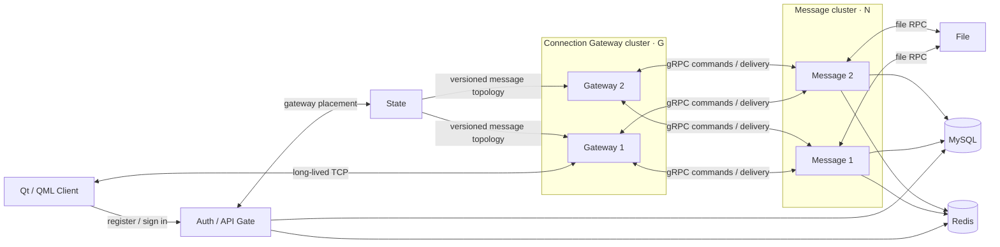

  

<h1 align="center">WIMI</h1>

  An experimental C++20 instant-messaging project. 
  <a href="README.zh-CN.md">简体中文</a> · English

> **Experimental and non-commercial.** WIMI is a learning and engineering
> experiment, not a production service. It has no public-service security or
> operational guarantee; do not expose it to the Internet or use it for
> sensitive data.

  

## Functionality

WIMI provides a Qt/QML desktop chat client backed by a C++ service stack. Its
current experience focuses on the everyday chat path:

- Account registration, email verification, sign-in, and reconnecting through
  the Auth Gate.
- Direct conversations, group text messages, delivery/read acknowledgements,
  and incremental conversation sync.
- Separate sessions for devices on the same account, with delivery and sync for
  online devices.
- File messages with resumable chunked transfer and SHA-256 verification.
  PNG, JPG, and Markdown files can be previewed; text and other files can be
  downloaded locally.
- Per-account SQLite storage for local history, drafts, outgoing messages,
  sync cursors, and unfinished file transfers.
- A responsive light/dark Qt interface with desktop notifications on Linux.

## Project highlights

WIMI breaks a chat service into small, understandable parts: one part handles
sign-in, one keeps client connections alive, one processes messages, and one
handles files. This makes it a practical project for learning how a chat
application moves from a desktop UI to a service cluster.

The current server can run several Connection Gateways and several Message
nodes (`G × N`). State tells the client which Gateway to use and tells each
Gateway which Message nodes are available. A conversation can therefore keep
working across Gateway and Message service instances.

## Architecture

## Try and build it

Detailed setup of this page:

- [Client guide](docs/client-guide.md) — build, run, local data, live service mode,
  tests, and Linux desktop integration.
- [Server requirements and local workflow](docs/requirements.md) — packages,
  database/Redis initialization, services, ports, and smoke tests.
- [Configuration guide](docs/configuration.md) — configuration files and
  override rules.
- [Server verification status (Chinese)](docs/feature-server-verification.md)
  — current service capability and known boundaries.

## Development

The repository is organized around a Qt client in `client/`, C++ services in
`server/`, shared protocols in `server/public/proto/`, and repeatable local
scripts in `scripts/`. The client uses C++20, Qt 6, QML, QtProtobuf, and
SQLite; services use C++20, gRPC, MySQL, and Redis.

Before changing the system, read the guides above and keep the experimental
scope in mind: TLS, secure credential storage, production deployment, and
several platform paths remain outside the verified baseline.
