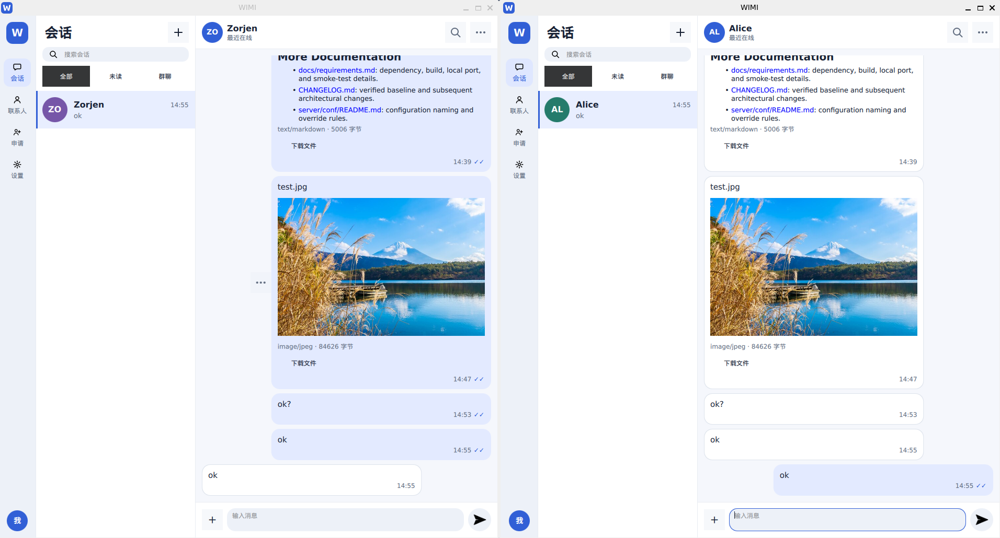
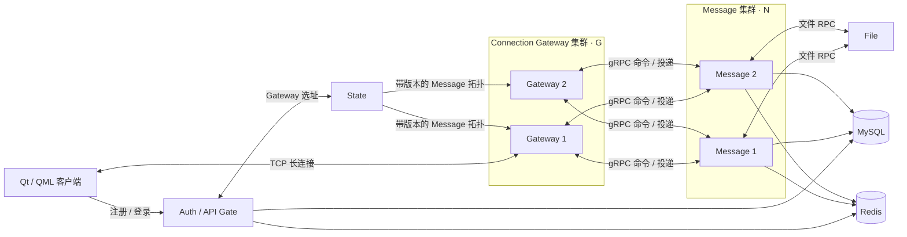

  

<h1 align="center">WIMI</h1>

  一个实验性的 C++20 即时通讯项目。 
  中文 · <a href="README.md">English</a>

> **实验性项目。** WIMI 用于学习和工程实践，不是可投入生产的服务；

  

## 功能

WIMI 提供基于 Qt/QML 的桌面聊天客户端，并配套 C++ 服务端。当前体验聚焦日常聊天
的核心链路：

- 通过 Auth Gate 完成注册、邮箱验证码、登录和重连。
- 单聊、群文本消息、送达/已读确认，以及会话增量同步。
- 同一账号的设备会话隔离，并向在线设备投递和同步消息。
- 支持断点续传和 SHA-256 校验的文件消息。PNG、JPG、Markdown 可预览；文本和其他
  文件可下载到本地。
- 按账号隔离的 SQLite 本地数据：历史消息、草稿、待发消息、同步游标和未完成文件传输。
- 支持浅色/深色与响应式布局的 Qt 界面；Linux 提供桌面通知。

## 项目特点

WIMI 将聊天服务拆成几个容易理解的小部分：登录、保持客户端连接、处理消息和处理文件。
它适合用来学习一条聊天消息如何从桌面界面进入服务端，并在多个服务实例之间完成处理。

当前服务端可运行多个 Connection Gateway 和多个 Message 节点（`G × N`）。State 会为
客户端选择 Gateway，也会把可用的 Message 节点信息交给 Gateway；因此一条会话消息可以
经过不同的 Gateway 和 Message 服务实例处理。

## 整体架构

## 尝试与构建

构建和联调细节请参阅：

- [客户端指南](docs/client-guide.zh-CN.md)：构建、运行、本地数据、真实服务模式、测试和 Linux
  桌面集成。
- [服务端依赖与本地流程](docs/requirements.zh-CN.md)：依赖安装、MySQL/Redis 初始化、服务启动、
  端口和 smoke 测试。
- [配置说明](docs/configuration.zh-CN.md)：配置文件与覆盖规则。
- [服务端验证状态](docs/feature-server-verification.md)：当前能力与已知边界。
