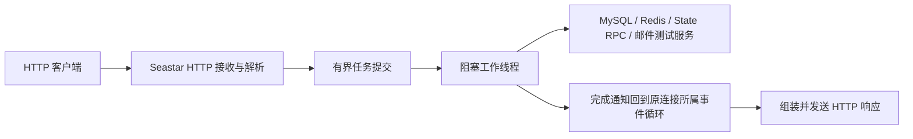

# 服务端网络改写与性能测试方案

本文记录实施方案与已经完成的阶段性验证。源码审查基于提交 `3c121e1`；外部资料核查日期为 2026-09-21。

先建立性能基线，再将 Gate HTTP 和 Gateway LV TCP 网络层改为 Seastar。Gateway 保留四字节网络序长度前缀与 Protobuf 负载，不迁移 WebSocket，也不引入 Boost.Beast。框架收益必须通过同协议、同业务和同资源预算的对照实验确认。

## 1. 范围、假设与交付标准

- 实施覆盖 Gate、Gateway，以及 Message、State、File 的模块测试与端到端测试。
- “各模块”包含五个服务进程；common 作为公共库做编解码、数据库访问等微基准，不虚构独立网络 TPS。MySQL、Redis、邮件服务作为依赖单独观察。
- IOPS 分为磁盘 IOPS 与网络读写操作次数；PPS 指明确测量位置的网络包速率；业务吞吐另外统计。它们不能互相代替。
- 当前没有目标机器、预期在线人数、业务比例、绝对 TPS 和延迟 SLO。先使用本文的实验档位与建议门槛建立基线，实测前冻结测试条件；绝对容量结论必须附带硬件与负载条件。
- C++23 已通过 Seastar、独立消费程序和全部服务端目标验证，因此未继续尝试 C++26。C++23 已统一用于整个 `server/`，包含五个服务、common、测试和 perf 目标。
- Gateway 客户端入口保留现有 LV TCP 协议，服务间仍使用现有 gRPC。smoke 与 perf 是本方案的优先交付和验收入口，Qt 客户端不在本方案范围内。
- Seastar 固定从 `/home/zongjing/workspace/ref/network/seastar/` 构建，采用上游 release 模式；标准安装前缀按 `/usr/local` 执行，服务端使用安装后的依赖。
- 不增加应用协议版本号、版本协商、双协议共存、数据迁移、降级或回退路径。

成功标准：有可复现的基线、有协议正确性证据、有明确的框架采用条件、有五个模块各自的 TPS 定义，并能区分网络、业务线程、数据库、磁盘与压测端瓶颈。

当前完成了主机 C++23 构建、Seastar 安装、Gate HTTP 与 Gateway LV TCP 改写、协议边界 smoke、双节点业务 smoke 和本地短时 perf 资格验证。短测结果保留原始请求样本、资源快照和正确性结果；由于运行在共享开发机和 loopback 上，不作为第 9 节的容量采用结论。正式容量、五次交错重复以及 1 小时/8 小时持续测试仍需在冻结硬件和 SLO 后执行。

2026-09-22 的本机复测使用 GCC 15.2、C++23、Release、两个 Seastar shard 和显式 `io_uring`。九个场景各以 40 TPS 运行 10 秒，每场 400 个计划事务全部成功，生成器没有漏发；协议探针、双节点业务 smoke 和优雅停机均通过。请求延迟 p99 为：固定 HTTP 3.599 ms、持久连接固定 HTTP 2.506 ms、登录 6.190 ms、持久连接登录 5.946 ms、LV TCP ping 2.176 ms、好友拉取 4.136 ms、State 选址 2.239 ms、State 拓扑 2.126 ms、64 KiB 文件往返 3.727 ms。Gate 和两个 Gateway 的启动日志均确认 `Reactor backend: io_uring`。

同一 GCC 15/C++23 工具链的 legacy 对照在七个公共场景中也全部达到 40 TPS，因而本档只证明正确性和采集链路。单次复测中 Seastar 候选的 p99 比 legacy 高约 3.2%–28.6%，总进程 RSS 高约 23.3%–24.2%，CPU/成功事务高约 4.8%–26.5%；共享 WSL2 主机和 loopback 的短测噪声较大，不能据此判定框架容量，但现有证据也不满足第 9 节的性能收益门槛。下一步必须在独立机器上做容量拐点、至少五次交错重复和物理网卡 PPS/带宽采集。

附加的 400 TPS、5 秒、8 压测线程探测中，候选九个场景和 legacy 七个公共场景也都无失败、无漏发。公共场景的成功 TPS 相同；候选 p99 在五项低 5.0%–35.7%、一项基本相同、好友拉取高 9.5%，CPU/事务仅 TCP ping 下降超过 20%，总进程 RSS 仍高约 23.2%–24.5%。这个档位尚未出现吞吐拐点，仍不满足“TPS 提升或业务 CPU 下降且 RSS 不增加超过 10%”的采用门槛。

## 2. 当前实现与影响范围

| 模块 | 已确认的实现与源码入口 | 对计划的影响 |
| --- | --- | --- |
| Gate | [HandleHttpRequest](../server/gate/src/main.cc) 在 Seastar 协程中读取有界请求体，再由 [SeastarExecutor::Submit](../server/common/include/SeastarExecutor.h) 将同步数据库、Redis 和 State 调用交给有界工作队列 | HTTP reactor 不执行阻塞业务；短连接与长连接需分别比较 |
| Gate 依赖 | [StateClient::PickConnectionGateway](../server/gate/src/StateClient.cc#L31) 是同步 RPC；[邮件发送路径](../server/gate/src/VerificationService.cc#L207) 使用同步调用 | 需要有限容量的阻塞任务执行器及返回事件循环的桥接 |
| Gateway | [SeastarGatewaySession::Run](../server/gateway/src/SeastarGateway.cc#L216) 精确读取四字节网络序长度及 Protobuf 正文 | 本文所说的“LV TCP”是长度前缀帧，无独立 T 字段；改写保留该线协议 |
| Gateway 业务 | [SeastarGatewaySession::HandlePacket](../server/gateway/src/SeastarGateway.cc#L381) 负责登录约束、租约刷新与转发限流；[SeastarGatewaySession::WriteLoop](../server/gateway/src/SeastarGateway.cc#L574) 串行发送 | 改写保留鉴权、业务分发、背压及可靠推送语义 |
| 服务间通信 | [MessageLink](../server/gateway/include/MessageLink.h#L17) 使用 gRPC 双向流；[MessageLinkManager](../server/gateway/include/MessageLinkManager.h#L23) 管理链路 | Seastar 连接分片需要显式桥接外部 gRPC 回调线程 |
| Message | [MessageService::AcceptText](../server/message/src/MessageService.cc#L25) 与 [MessageService::AcceptGroupText](../server/message/src/MessageService.cc#L77) 先保存业务消息；重复请求不产生相同的新转发 | 区分新消息提交 TPS、幂等重试处理速率和下行投递速率 |
| State | [StateServiceImpl::PickConnectionGateway](../server/state/src/service.cc#L53) 与 [StateServiceImpl::ListMessageNodes](../server/state/src/service.cc#L72) 提供节点选择和拓扑查询 | 以成功 RPC 作为事务，不以聊天室事务计数 |
| File | [FileServiceImpl::Upload](../server/file/src/Service.cc#L93) 与 [FileServiceImpl::Download](../server/file/src/Service.cc#L173) 使用同步文件操作和服务级互斥；完成上传包含全文件校验 | 分开测块操作、完整文件、锁竞争和磁盘；成功响应不能直接解释为断电持久化 |
| 测试入口 | [Python smoke 客户端](../scripts/smoke/src/wimi_tcp_client.py#L249) 使用 LV TCP | 直接复用协议行为，优先扩充 smoke 与 perf；Qt 客户端不在范围内 |
| 现有验证 | [公共测试注册](../server/test/common/CMakeLists.txt#L11)、[Gate 测试注册](../server/test/gate/CMakeLists.txt#L1)、[File 测试注册](../server/test/file/CMakeLists.txt#L1)、[工作区验证流程](../WORKSPACE.md#L3) | 现有单测和 smoke 用作正确性基础；不能作为严谨容量基准 |

当前还有两个会直接影响压测结论的约束：转发命令每连接每秒超过 100 次会被拒绝，见 [SeastarGatewaySession::HandlePacket](../server/gateway/src/SeastarGateway.cc#L381)；[SeastarGatewaySession::QueueFrame](../server/gateway/src/SeastarGateway.cc#L545) 同时限制发送队列条数和字节数。压测必须报告限流和背压，不能把这些上限误认为网络框架上限。

## 3. Gate：Seastar 改写方案

Seastar 使用按核事件循环和显式跨核通信，阻塞调用不应直接进入事件循环。这决定了改写范围包含业务执行边界，而不仅是 socket API。[官方教程](https://docs.seastar.io/master/tutorial.html)

实现结构：



实施步骤：

1. [wimiPerf](../server/bench/main.cc) 提供 HTTP 固定响应和真实登录两种场景。前者测网络开销，后者完整经过 MySQL、Redis、State；固定响应的提升不能替代真实业务结论。
2. [Service::Handle](../server/gate/src/Service.cc) 已解除业务与 HTTP 框架请求/响应对象的耦合。解析结果按值传递给业务，返回普通 [ServiceResponse](../server/gate/include/Service.h)，由 Seastar HTTP 层负责响应。
3. 数据库、同步 RPC、邮件调用进入有界工作队列。限制并发和排队字节，队列满时明确拒绝；同一数据库连接不能被多个工作线程并发使用。审查现有单例、连接池和日志的线程安全。
4. 外部线程通过经过验证的通知桥接把结果送回原事件循环。禁止从工作线程直接操作连接或完成属于另一事件循环的异步对象；请求结束后晚到结果只能释放资源。跨线程对象的创建、释放和分配器归属纳入原型验证。
5. 网络层完成请求体上限、读写生命周期、断开取消和停机排空；不借机引入全局请求上下文超时机制。阻塞依赖使用各自已有或必要的调用边界限制。
6. 覆盖已有 HTTP 路由、登录凭证签发、注册、密码重置和验证码逻辑。邮件吞吐测试使用本地测试接收端，同时单独报告禁用邮件投递时的结果。

比较当前实现与使用同样业务隔离方式的 Seastar 实现。HTTP 连接复用、业务线程预算、数据库池、日志和响应内容保持一致；长连接收益单独列出，避免把它归因于 Seastar。

工具链验证、release 构建和标准位置安装已按第 3.1 节完成。C++20 不再作为 Seastar 构建候选。

采用条件：全部功能通过，事件循环无依赖调用导致的阻塞，停机和连接销毁无越界访问，且在相同资源预算下满足第 9 节的收益门槛。若瓶颈落在数据库或邮件，记录“不支持全面改写的性能依据”，不要继续扩大改写范围。

### 3.1 Seastar 构建安装与服务端标准统一

以指定目录的本地源码为准。[本地 Seastar 构建说明](/home/zongjing/workspace/ref/network/seastar/README.md:147) 明确支持 C++23 与 C++26；[安装说明](/home/zongjing/workspace/ref/network/seastar/README.md:109) 使用 `/usr/local`，无需把依赖复制进项目。

执行顺序：

1. 记录本地源码提交及工作区差异，检查依赖、编译器、标准库与 CMake；先以 C++23 配置并完整构建，再运行必要测试及最小消费程序。若不能满足要求，先区分缺少依赖、编译器问题与语言标准问题，处理环境问题后再尝试 C++26；单纯下载或链接失败不能作为升级标准的依据。
2. C++23 验证通过就将其作为服务端统一标准；否则继续验证 C++26。两者均未通过时记录具体阻塞项，不宣称构建完成。不同标准使用独立构建目录，防止缓存与产物混用。
3. 使用本地官方 release 模式。该模式在 [构建脚本](/home/zongjing/workspace/ref/network/seastar/configure.py:275) 中映射到 CMake 的 `RelWithDebInfo`，保留调试信息并启用生产优化；报告中同时记录模式和实际编译参数，避免将其与普通 CMake `Release` 混淆。
4. 将验证通过的一套产物安装到 `/usr/local`，保留安装文件清单。核实头文件、库、CMake 包和 pkg-config 元数据均已安装；库目录由安装结果确定。使用动态库时刷新系统动态链接器缓存并验证运行时解析。
5. 服务端通过安装后的 CMake 包查找依赖，不引用 Seastar 源码树或构建目录。用新的独立构建目录完成最小程序的配置、链接和运行，验证依赖发现不依靠残留缓存；相关传递依赖也必须可从安装环境找到。
6. 在 [服务端顶层构建](../server/CMakeLists.txt#L4) 集中定义选定标准，清理各模块覆盖 C++20 的设置，保证 common、Gate、Gateway、Message、State、File、测试与 perf 全部继承。核对编译数据库中的实际参数；将同一编译器、标准库和语言标准同步到宿主机构建、Docker 构建及 CI。

实际验证使用本地 Seastar 提交 `56fd8eeb52d730fe5f323b1c3b9ef2919c7d258c`、GCC 15.2、C++23 和禁用 DPDK 的 release 构建。构建目录为 `build/wimi-gcc-cxx23`，安装后的 `pkg-config` 版本为 `1.0`。上游 `coroutines_test`、`websocket_test` 和独立消费程序通过；WebSocket 测试只验证本次 Seastar 安装，不改变 Gateway 保留 LV TCP 的决定。执行命令如下：

```bash
cd /home/zongjing/workspace/ref/network/seastar
SEASTAR_CXX_STANDARD=23
SEASTAR_CXX=/usr/bin/g++
SEASTAR_CC=/usr/bin/gcc
SEASTAR_BUILD_ROOT=build/wimi-gcc-cxx23
SEASTAR_BUILD_JOBS=2

./configure.py --mode=release --c++-standard="$SEASTAR_CXX_STANDARD" \
  --compiler="$SEASTAR_CXX" --c-compiler="$SEASTAR_CC" \
  --build-root="$SEASTAR_BUILD_ROOT" --prefix=/usr/local \
  --enable-io_uring --disable-dpdk
cmake --build "$SEASTAR_BUILD_ROOT/release" --parallel "$SEASTAR_BUILD_JOBS"
```

构建与必要测试通过后，对选定产物执行安装（写入系统目录时使用所需的系统权限）：

```bash
cmake --install "$SEASTAR_BUILD_ROOT/release"
```

安装与服务端统一构建的验收包括：独立消费程序运行通过、全部服务端目标构建通过、基础测试与 smoke 通过、编译数据库无模块意外继续使用 C++20。若修改 Docker 构建，按工作区要求追加集群 smoke。框架性能对照必须使用统一后的工具链重新生成基线。

## 4. Gateway：Seastar LV TCP 改写

### 4.1 协议约定

每个 [ClientEnvelope](../server/common/proto/tcp_message.proto#L548) 继续编码为四字节网络序长度和紧随其后的 Protobuf。接收循环先精确读取长度，再按 [PROTOCOL_RECV_MSS](../server/common/include/Const.h#L45) 拒绝超限负载，最后精确读取并解析一个信封。

- 请求关联、鉴权、业务 ACK、幂等键、可靠推送、租约和现有限流语义保持不变。
- 每连接只有一个读协程和一个写协程。写队列同时限制条数与字节数，未确认可靠推送另设条数和字节上限。
- Seastar 临时缓冲区持有到异步写完成；本分片内优先移动所有权。gRPC 外部线程到所属分片的边界允许一次明确的所有权转移或复制，并记录在性能分析中。
- 覆盖拆包、粘包、零长度、超长声明、正文提前结束、非法 Protobuf、慢读、慢写和异常断开。

### 4.2 运行时和线程边界

Gate 和 Gateway 显式使用 Seastar 的 `io_uring` reactor backend。宿主机运行器与 Compose 命令都传入 `--reactor-backend io_uring`，不把自动探测结果当作部署约束；启动日志必须出现 `Reactor backend: io_uring`。

会话和可变写状态归连接所属 Seastar 分片。同步 MySQL/Redis 操作进入有界工作队列；现有 gRPC 双向流继续由其 Asio/gRPC 运行时管理。外部回调只持有连接标识和所属分片，通过 `seastar::alien` 返回后再查找会话，不能跨线程直接访问 socket 或分片对象。

每对 Gateway–Message 的复用流由现有管理器拥有，不随 Seastar 分片数放大。登录绑定、租约刷新、命令投递和断连清理都计入工作桥的条数与字节预算；满载时返回明确背压或关闭产生积压的连接。停机顺序是停止接收、停止新任务、等待在途任务、关闭 gRPC 链路，最后销毁分片会话。

### 4.3 优先交付 smoke 与 perf

Qt 客户端的代码和构建依赖不在本方案内。下文的端到端测试均由 smoke 或 perf 测试客户端驱动；现有 LV TCP 线协议保持不变。

- 复用并扩充 [smoke 客户端](../scripts/smoke/src/wimi_tcp_client.py#L249) 和 C++ perf 驱动，校验认证、请求关联、拆包/粘包、收发与对账。
- 覆盖单聊、群聊、好友、回执、离线拉取、多设备、文件分块和跨节点行为；协议不变使基线与 Seastar 候选可以使用相同请求字节。

## 5. 指标口径与采集边界

所有速率采用稳定窗口内的计数差除以实际秒数。上行、下行、客户端入口和服务间链路分开记录，不跨网卡、容器桥接或服务重复加总。

| 指标 | 本方案定义 | 数据来源及注意事项 |
| --- | --- | --- |
| 网络 PPS | 指定接口收包/发包增量每秒 | 主机接口与 NIC 硬件计数分别记录；TCP ACK、重传包含在网络包中，不等于业务消息数 |
| 网络带宽 | 接口字节增量每秒；另报有效业务载荷字节每秒 | 明确十进制 bit/s 与二进制 MiB/s，不将应用载荷称为线速 |
| 网络 I/O ops/s | 指定边界完成的 socket 读/写操作每秒，分别报告 | 异步 API 完成数和系统调用数是两种口径；批量发送会降低操作数，不意味着能力下降 |
| 磁盘 IOPS | 块设备完成读/写次数每秒 | 在 File、MySQL、Redis 持久化所在主机采集；无持久化职责模块标记不适用，日志 I/O 单列 |
| RPS / RPC/s | 已完成请求或 RPC 次数每秒 | 区分业务成功、业务拒绝、传输失败；gRPC 流内命令另计，不把一条长流当作所有事务 |
| TPS | 达到预先声明业务完成点的唯一事务数每秒 | 第 6 节逐模块定义；重试不增加唯一业务成功数 |
| 连接能力 | 建连/握手/认证成功每秒，在线连接数、每连接内存 | 区分空闲与活跃连接；TLS 握手另测 |
| 延迟 | p50、p95、p99、p99.9、最大值及超时比例 | 分别输出成功和失败；保留直方图与样本数，不平均各机器的百分位 |
| 资源与拥塞 | CPU 时间、每成功事务 CPU 成本、RSS、线程、FD、重传、丢包、队列深度及字节数 | 同时采集压测端和依赖，定位先饱和的一环 |

网络计数优先使用系统接口和硬件计数，参考 [Linux 网络统计](https://docs.kernel.org/networking/statistics.html)。固定 MTU、GRO/GSO/TSO、网卡队列与中断配置；软件计数受卸载和观测位置影响，不能直接称为物理线速 PPS。共用网卡时做链路隔离或按流归属采集，不能把整机流量分摊成未经验证的模块数据。

磁盘使用块设备计数及 `iostat`，语义参考 [Linux I/O 统计](https://docs.kernel.org/admin-guide/iostats.html)。File 的页缓存写入完成不等于设备写入完成，数据库提交也需附持久化配置。单独运行 [fio](https://fio.readthedocs.io/en/latest/fio_doc.html) 描述测试磁盘能力，不能将 fio IOPS 当作 File 服务性能；仅操作隔离的测试文件，不与正式业务压测同时争用磁盘。

采集优先放在压测客户端、进程/容器和系统边界；必要的队列观测集中在网络或执行器边界。结合 [现有任务清单](../TASKS.md#L8)，不在每个业务函数内增加全局统计分支。高开销追踪只用于诊断实验，记录开启观测前后的成本。

## 6. 各模块测试矩阵与 TPS 定义

| 模块/链路 | 场景 | 一次成功事务的完成点 | 必须额外报告 |
| --- | --- | --- | --- |
| Gate | 固定响应、登录、注册、验证码、密码重置；短连接与长连接 | 客户端收到业务成功结果；登录包含有效凭证和 Gateway 地址 | 各接口 TPS 分列，HTTP 成功状态不能替代业务成功；邮件是否真实投递到测试接收端 |
| Gateway 本地 | 握手、认证、本地连接检查、断开 | 握手结束 / 登录成功响应 / 检查响应，分别定义 | 不把连接检查 TPS 当聊天 TPS；在线数、建连速率、CPU、RSS |
| Gateway 转发 | 有效认证下转发、下行推送、慢客户端 | 收到匹配业务响应；推送以接收端解码成功另计 | 命令/s、投递/s、拒绝率、队列字节、同节点与跨节点 |
| Message 直接入口 | 已注册的有效 Gateway gRPC 流，真实 Redis 租约、MySQL 与用户关系 | 收到业务成功响应并按测试数据核对存储结果 | 每业务 TPS，数据库等待，工作队列，流内并发；不能用普通 unary RPC 压测替代 |
| 单聊端到端 | 发送、在线投递、到达回执、离线后拉取 | 分别定义唯一消息受理、目标设备收到、服务端确认回执 | 各完成点吞吐和延迟，消息重复/缺失、会话顺序、用户与设备数 |
| 群聊端到端 | 多群与热点群；10/100/1000 人 | 一次唯一群消息成功受理计 1 个发送事务 | 成功接收设备投递/s、群大小、在线比例；不能把一次群发计成多笔发送事务 |
| 好友/群管理 | 申请、批准、删除、建群、入群、退群 | 对应操作成功并验证关系状态 | 单操作 TPS 与整个业务流程完成数分列；每轮准备合法前置状态 |
| State | 节点选择、拓扑查询；不同节点规模 | 成功响应且内容符合测试拓扑 | 各方法 RPC/s 与 p99；空拓扑拒绝实验单列 |
| File 直接入口 | 分块上传、完成校验、下载 | 块成功确认；完整文件完成且摘要验证成功，分别计数 | 块 ops/s、完整文件 TPS、MiB/s、磁盘 IOPS、锁等待、冷热缓存 |
| 文件端到端 | 客户端经过 Gateway、Message、File 上传/下载 | 上传完成并可下载、下载后摘要正确 | 分别报告整条链路和直接 File 的差距 |
| common / 依赖 | 序列化、解析、数据库操作、Redis 访问 | 单次操作完成 | 仅报告微基准 ops/s、分配和依赖延迟，不加入端到端 TPS 总和 |

消息测试先创建用户、好友、会话、群和有效租约；使用每轮唯一的请求与业务幂等标识。Gate 的登录凭证按用户覆盖，见 [Service::signIn](../server/gate/src/Service.cc#L249)，因此并发登录基准默认使用不同用户；同用户登录竞争另作场景，不能污染正常成功率。

计数规则：稳定窗口内完成的唯一成功事务用于 TPS；另对窗口内计划发出的全部请求做有限时间的结算，记录计划数、实际发送数、成功数、拒绝数、超时数和未决数。停止发压后收到的结果归入结算，不补进稳定窗口吞吐。

消息受理成功与投递成功是不同事实；按唯一业务标识对账提交、数据库、接收端和回执。允许业务机制产生重传，但必须显示重传量和重复投递量；不能发生重复持久化、内容错误、越权投递或声称成功却无法解释的缺失。大规模测试若抽样校验存储，注明抽样比例，并用独立正确性轮次完成全量对账。

## 7. 负载、实验方法与可复现性

### 7.1 三层测试

1. 协议/网络层：固定响应或测试 Echo，隔离编解码与传输成本。只作诊断，不代表业务容量。
2. 单模块层：真实接口及真实依赖；需要假依赖时标明为“隔离上限实验”，与真实结果分开。
3. 全链路层：单 Gateway/Message 与双 Gateway/Message 两种拓扑，覆盖同节点和跨节点。既测固定总 CPU 的扩展效率，也测增加资源后的容量，明确两者区别。

### 7.2 初始档位

| 维度 | 初始实验值 | 使用方式 |
| --- | --- | --- |
| 在线连接数 | 100、1,000、10,000，再按资源逐步上探 | 先空闲，再 10%/50%/100% 活跃；不是容量承诺 |
| 消息载荷 | 64 B、256 B、1 KiB、4 KiB、64 KiB | 记录 Protobuf 与四字节长度头后的实际大小；超限输入单独做拒绝测试 |
| 文件 | 64 KiB、1 MiB、100 MiB；块大小 64 KiB、256 KiB、1 MiB | 块长必须小于封装后的消息上限，覆盖最终校验成本 |
| 数据分布 | 均匀用户/会话，多会话热点，单热点会话或群 | 区分数据库串行竞争和网络框架能力 |
| 混合业务 | 初始示例：70% 单聊、20% 群聊、10% 查询 | 只是发起请求比例，不包含由此产生的推送和 ACK；独立单业务测试仍必须保留 |
| 异常负载 | 慢读、断连、重复请求、连接突增、依赖延迟、单节点退出 | 单独报告损失、积压、拒绝和恢复正常负载所需时间 |

转发负载先控制每连接低于现有限流，靠增加有效连接提升总吞吐；另做接近及超过限流的拒绝实验。本地检查与转发业务分开，避免只测绕过转发限制的轻请求。

### 7.3 发压与计时

- 容量测试采用开环目标到达率，实际业务行为可另用闭环用户模型。慢服务不能自动降低发压速率后仍声称满足目标。
- 每条请求记录计划发送、实际发送、完成时刻；同时输出调度延迟、实际请求延迟和从计划时刻起算的延迟。未发出、客户端队列满、超时都必须出现在结果里，避免 coordinated omission。
- 压测客户端使用单调时钟。跨机投递延迟使用经过校准的时钟并报告误差，或让发送与接收由同一压测进程计时；不直接相减两台未校时机器的时间戳。
- 初始预热 2 分钟、稳定测量 10 分钟、每档至少 5 次独立重复；若还未稳定就延长预热。以基线可持续吞吐的 25%、50%、75%、90%、100%、110% 扫描，再在拐点附近细化。
- 候选交错运行，控制缓存与数据增长。报告每轮结果、中位数、离散程度及独立轮次的区间估计；增加重复次数后区间仍重叠就写“证据不足”。p99.9 样本不足时不作承诺。
- 完成 1 小时初步持续测试后，对最终候选做至少 8 小时压力稳定性测试。检查 RSS、FD、队列、未完成请求是否持续增长；过载结束后检查资源是否释放。
- 分离压测机器和被测机器；多机发压后吞吐仍不提高且压测端有资源余量，才支持“服务端饱和”的判断。检查客户端 CPU、端口数、FD、网卡和调度延迟。

HTTP 固定响应可用 [wrk2](https://github.com/giltene/wrk2) 作定速诊断，但真实登录需要检查响应体中的业务结果。LV TCP、gRPC 双向流和完整业务事务使用理解本项目协议、采用服务端统一 C++ 标准的压测客户端；Python smoke 用于正确性，不承担容量测量。

### 7.4 环境记录与结果归档

每轮归档：源码提交与未提交差异、依赖源码标识、编译器及优化参数、CPU 型号/核数/绑核/NUMA、内存、内核、NIC/驱动/速率/MTU/卸载、TLS 位置、容器资源限制、各线程与数据库池预算、MySQL/Redis 持久化策略、磁盘与文件系统、数据规模、日志级别、负载随机种子及完整命令。

现有 [服务端构建脚本](../scripts/build-server.sh#L21) 未显式指定优化构建类型，正式压测必须使用独立构建目录并明确优化参数。现有 [临时调优脚本](../scripts/tune-perf-temp.sh#L1) 只作为可选实验条件；基线与候选必须一致，不能一方调优而另一方保持默认。

已经落地的文件布局：

```text
server/bench/                  采用服务端统一 C++ 标准的协议与业务压测客户端
scripts/perf/                  隔离数据准备、协议检查、执行、采集、对账、比较和诊断
docs/performance/              运行入口、指标边界和正式测试要求
build/perf-results/<run-id>/   本地清单、逐请求样本、资源快照、日志和正确性结果
```

原始结果与图表关联同一运行标识；测试凭证不写入归档。独立测试库和文件目录负责数据准备与清理，不重置开发者正在使用的数据。

## 8. 实施顺序与每阶段验收

下面是单名开发者的粗估工作量，未包含等待机器和上游问题修复；协议原型阶段结束后重新估算，不把估算视为交付日期。

| 阶段 | 工作与交付 | 验证/退出条件 | 粗估 |
| --- | --- | --- | --- |
| P0 基线 | 冻结指标与环境，建立原 TCP、HTTP、内部 gRPC 和五模块基础场景 | 正确性对账通过；原始结果可复现；压测端不是瓶颈 | 4–6 人日 |
| P1 构建与最小原型 | 按 C++23 → C++26 验证本地 Seastar release 构建，安装到 `/usr/local`，统一服务端标准；完成 Gate 真实登录及 Gateway LV TCP 消息边界、gRPC 桥接原型，配套最小 smoke/perf | 安装后独立消费成功；全部服务端目标使用选定标准；协议、生命周期及线程边界通过测试 | 6–10 人日 |
| P2 Gateway 实现 | 用 Seastar 改写 Gateway LV TCP 网络层、线程桥、smoke、perf、配置文档及协议测试 | 拆包/粘包/超限/慢客户端测试通过；smoke 覆盖单节点与双节点业务；perf 完成首轮真实链路测量 | 5–8 人日 |
| P3 Gate 实现 | 仅在 P1 证据支持采用时完成 HTTP 与业务边界改写 | 全路由测试、依赖压力、并发和停机验证通过；真实登录比较通过 | 5–8 人日 |
| P4 完整性能套件 | 扩充群聊、好友、文件、热点、错误注入和持续测试；建立报告与自动化 | 五模块与全链路都有 TPS 定义和测量；PPS/IOPS/延迟/资源可关联；所有差异可解释 | 5–8 人日及持续测试时间 |

依赖关系：P0 → P1 → P2/P3 → P4。smoke 与 perf 从 P0 起建设，并在 P1/P2 配合协议实现交付，P4 负责扩充与完整测量；Qt 客户端迁移不作为上述任何阶段的依赖。P1 确定工具链后，先用同一编译器和标准重测未替换网络实现的基线，区分语言工具链变化与框架变化的影响。P2 与 P3 在技术上相互独立，但全链路比较要分别记录每项改动的影响。任何协议正确性门槛未通过时，不进入宣称容量提升的阶段。

每次 C++、Proto、配置改动执行 [工作区规定的构建与基础测试](../WORKSPACE.md#L7)；Docker 或跨节点行为改动执行 [集群 smoke](../WORKSPACE.md#L35)。另外运行 smoke 测试客户端、LV TCP 边界测试和 perf 短测；完整容量测试放专用机器，日常 CI 只做协议、业务正确性和小规模资源泄漏检查。

## 9. 验收门槛与最终决策

以下是建议的实验决策标准，需在正式测量前冻结；它们不是已有实测结果，也不是无硬件条件的容量承诺。

1. **正确性硬门槛**：必要协议用例全部通过；无重复业务写入、错误内容、越权交付或无法解释的成功消息缺失；重传可发生但计数与业务语义一致。
2. **可持续容量定义**：在预先设定 p99 延迟目标下，预期成功请求的非预期失败率不超过 0.1%，队列和内存无持续增长，压测端能保持目标发压率。主动错误场景与预期拒绝单列，不能借此降低正常错误率。
3. **Seastar 采用收益**：相对同业务、同协议、同资源控制组，可持续业务 TPS 提升至少 20%，或相同成功 TPS 下每事务 CPU 时间下降至少 20%；同时 p99 不劣化超过 5%、RSS 不增加超过 10%，且差异超过实验波动。若只在空响应场景获益，不满足业务改写依据。
4. **LV TCP 交付验收**：基线与候选使用相同协议字节和业务数据；拆包、粘包、超限、断连和慢客户端行为必须通过，线协议行为不得漂移。
5. **持续稳定性**：最终候选完成持续测试，连接和队列占用稳定；慢客户端及依赖异常不会拖垮所有连接；测试结束能够排空或明确拒绝剩余工作并释放资源。
6. **交付报告**：按模块和场景列出硬件、总资源预算、完成点、成功 TPS、拒绝率、延迟、PPS、带宽、网络操作数、适用的磁盘 IOPS、CPU/RSS及正确性结果；画吞吐—延迟、负载—错误率、连接数—内存曲线，而不只展示峰值。

正式实施前仍需填写：目标部署硬件与资源预算、期望连接数及活跃比例、业务混合比例、各事务的 p99 SLO、TLS 终止方式、期望文件大小和持久化要求。缺少这些条件不妨碍完成基线工具，但不能据此宣称达到业务容量目标。
